# Efficient Search on Encrypted Cloud Data Using Joint Keywords (FMJK)

**Project report** &nbsp;|&nbsp; Team: Dinesh Kumar Gudiputi, Naga Lakshmi

---

## Abstract

> Cloud users encrypt their documents before upload, but indexing every keyword on its own makes the index large and the search slow. This project follows the FMJK method (features to match joint keywords), built on the MRSE scheme. It groups keywords into *joint keywords*, matches them against document features and query keywords to build a small index and a search trapdoor, and ranks results with an improved BM25 inner product. The accompanying web application, **FileSecure**, covers the data owner, data user and cloud server workflow for sharing encrypted files.

Full abstract: [`docs/abstract.docx`](docs/abstract.docx) &nbsp;|&nbsp; Report: [`docs/project_document.pdf`](docs/project_document.pdf) &nbsp;|&nbsp; Slides: [`docs/presentation.pptx`](docs/presentation.pptx)

## 1. Problem

Most existing ciphertext ranked-retrieval methods use KNN techniques to build the index. Indexing encrypted documents with independent keywords raises storage overhead and slows search, and both time and storage depend on the dimensions of the key, the index and the query. Reducing those dimensions is the route to faster search, as long as privacy and ranking accuracy hold.

## 2. Method

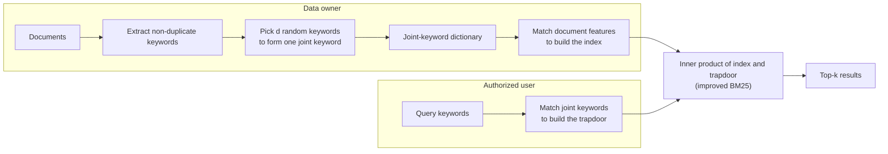

What it contributes, per the abstract:

1. Each joint keyword maps to **one** index dimension, so the key, index and trapdoor get smaller and the matrix work during encryption gets simpler.
2. The improved BM25 inner product sorts quickly and keeps query accuracy.
3. Random joint keywords plus the expanding and splitting steps in encryption protect privacy.

## 3. The application: FileSecure

A Django web application with three roles.

| Role | What they do |
| --- | --- |
| **Cloud server** | Logs in to a dashboard with statistics, accepts or rejects data owners and uploaded documents, views downloads |
| **Data owner** | Registers with an email OTP, uploads files, adds a description and keywords, encrypts the file (Fernet), accepts or rejects download requests, sees the top downloaded documents |
| **Data user** | Registers with an email OTP, searches documents, requests a download, receives a security key, decrypts the file and downloads it |

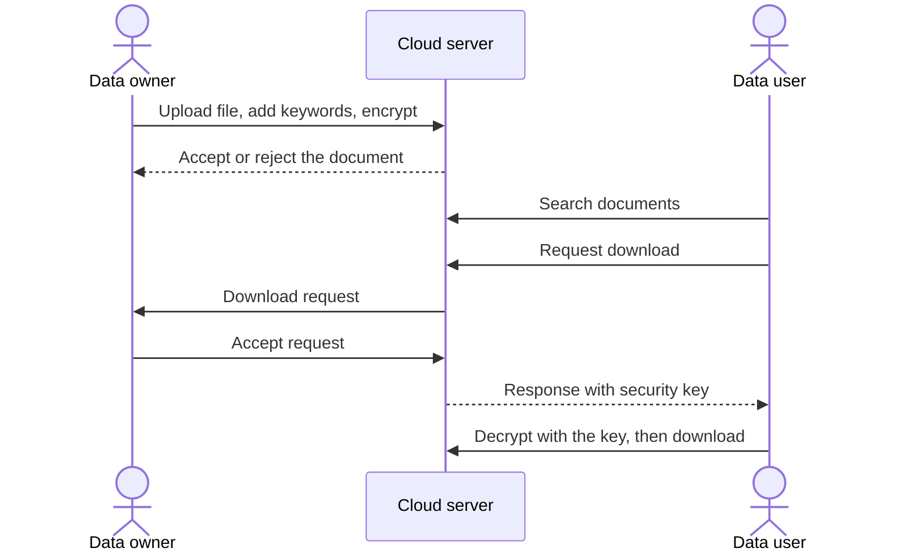

The FMJK ranking itself is described in the paper and the report. The application code in [`source/source_code.docx`](source/source_code.docx) covers the workflow above.

## 4. Screenshots

**Cloud server**

| Dashboard | Approve data owners | Uploaded documents |
| --- | --- | --- |
| 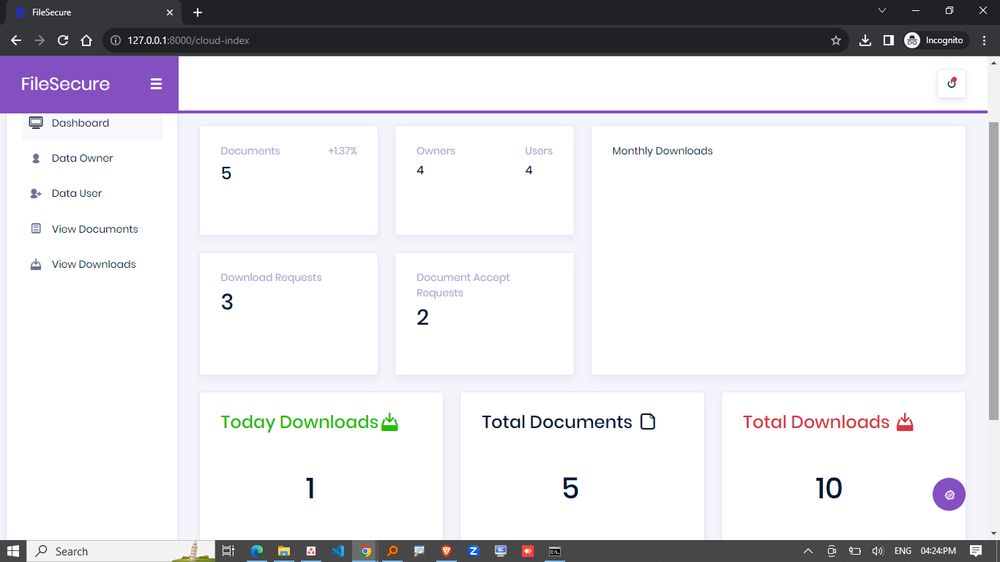 | 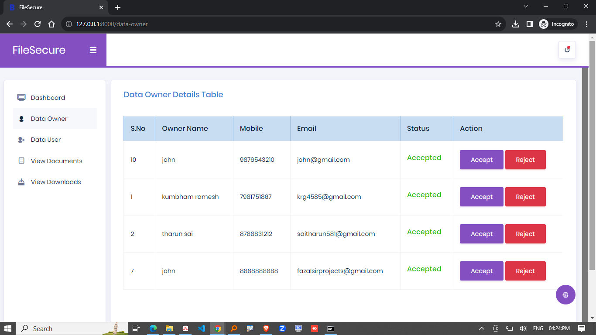 | 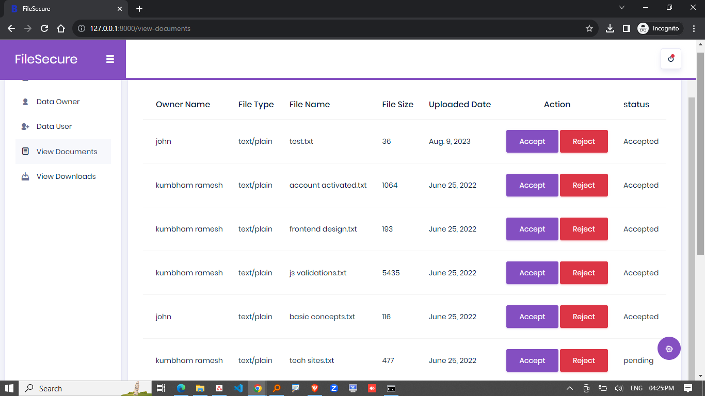 |

**Data owner**

| Upload a file | Download requests | Top downloads |
| --- | --- | --- |
| 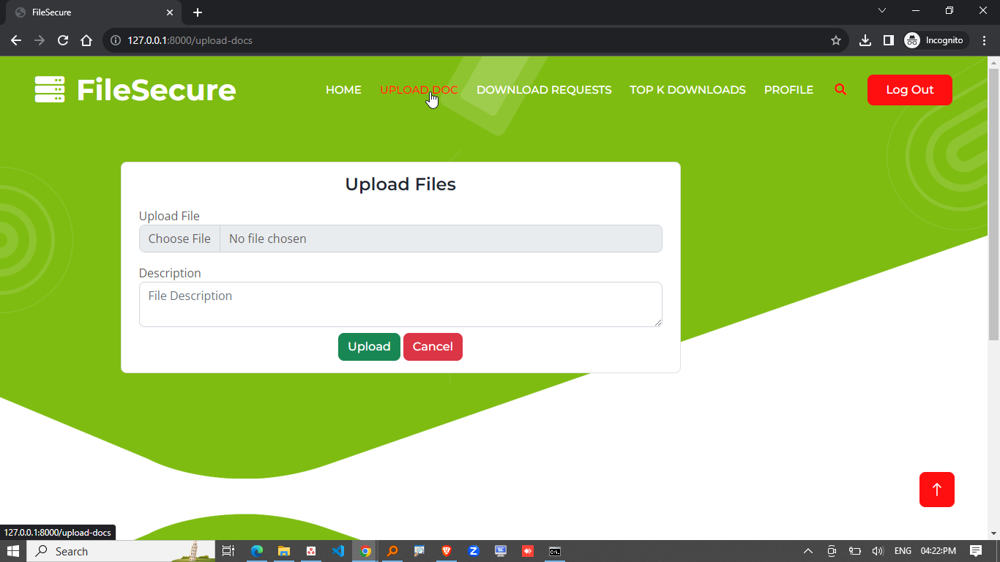 | 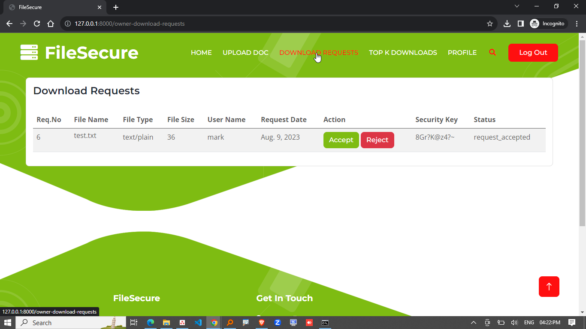 | 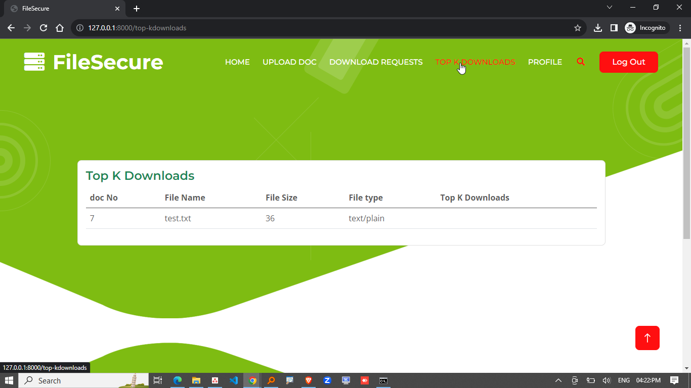 |

**Data user**

| Search documents | Response with security key | Downloads |
| --- | --- | --- |
| 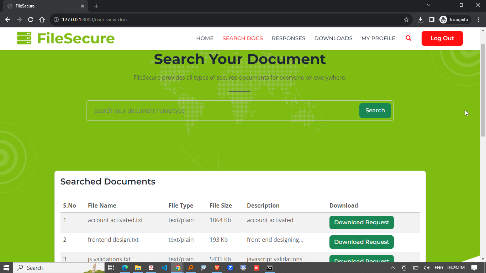 | 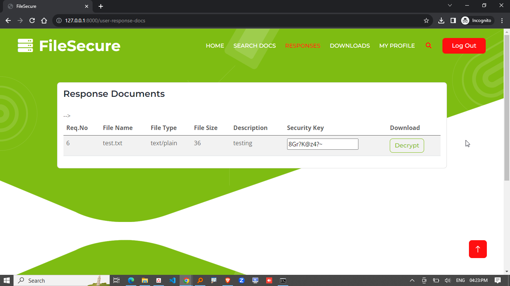 | 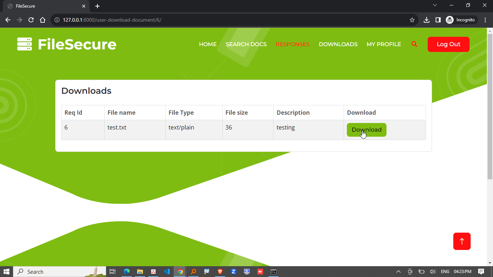 |

All 27 screenshots are in [`screenshots/`](screenshots/).

## 5. Technology and requirements

| | |
| --- | --- |
| Language and framework | Python 3.10, Django |
| Database | MySQL through a WAMP or XAMPP server, dump in [`database/filesecure.sql`](database/filesecure.sql) |
| Front end | HTML5, CSS3, JavaScript |
| Encryption | Fernet from the Python `cryptography` library |
| Tools | Visual Studio Code, Rational Rose for modelling, Windows 10/11 |
| Minimum hardware | Pentium IV 2.2 GHz, 1 GB RAM, 20 GB disk (developed on an i3 with 4 GB RAM) |

Details: [`docs/system_requirements.docx`](docs/system_requirements.docx), [`docs/software_environment.docx`](docs/software_environment.docx).

## 6. Repository contents

```text
.
├── docs/
│   ├── abstract.docx, project_document.pdf, presentation.pptx
│   ├── software_environment.docx, system_requirements.docx
│   └── reference/            base paper and journal paper
├── source/source_code.docx   application code (Django views and models)
├── database/filesecure.sql   MySQL dump
└── screenshots/              27 screenshots of the running application
```
